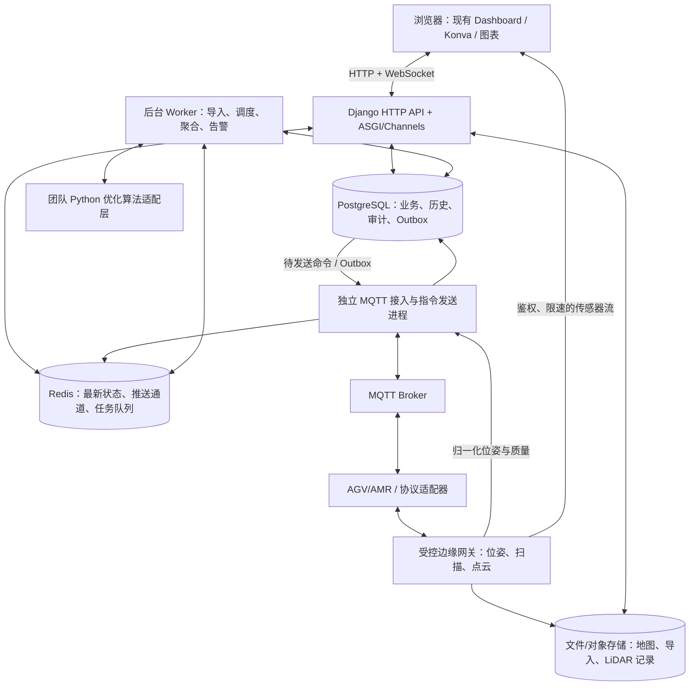

# AMR/AGV 车队管理系统需求分析

文档版本：v0.2（需求讨论稿）  
编写日期：2026-11-25  
最后更新：2026-11-26  
适用项目：Fleet_Management_System  
架构前提：延续现有 Django、PostgreSQL 和 Dashboard 页面布局，逐步扩展业务模块与后台服务。

本文描述目标需求、建议架构、接口边界和分阶段验收标准。除第 1 节列明的现状外，其余均为待开发建议；协议、配置和性能指标不代表系统当前已具备相应能力。

## 1. 现有基础与建设目标

### 1.1 现有代码基础

| 部分 | 当前实现 | 后续处理 |
|---|---|---|
| 项目配置 | `core/` 提供 Django 配置、HTTP 路由、WSGI/ASGI 入口；数据库配置指向 PostgreSQL | 保留，补充实时通信、后台进程和环境配置 |
| 页面结构 | `dashboard/base.html`、顶部栏、侧边栏、AdminLTE/Bootstrap 样式 | 保留布局，扩展现有菜单、卡片、表格和图表 |
| 用户功能 | 自定义用户、登录/登出、注册、资料修改、用户查询；已有 ORM 写库 | 复用身份体系，补充服务端权限、场地范围和审计 |
| 地图布局 | Konva 展示与编辑节点/连线；读取、覆盖保存 `factory_layout.json` | 升级坐标标定、数据库版本管理、校验与发布流程 |
| 控制台 | 车辆统计及电压、电流图表使用固定数字/数组 | 替换为车辆、订单和任务的真实聚合数据 |
| 车队业务 | 未发现车辆、订单、任务、遥测等业务模型和数据闭环 | 新增领域模型、服务和接口 |
| 车辆接入 | 未发现 MQTT 连接、订阅、发布及车辆协议适配 | 新增独立接入进程和厂商协议适配器 |
| LiDAR/定位 | 未发现传感器接入、坐标变换及定位集成 | 新增车端/边缘网关适配与定位质量管理 |

现状依据包括 `dashboard/views/admin_views.py`、`dashboard/models/custom_user.py`、`dashboard/views/layout_views.py`、`dashboard/templates/dashboard/dashboard_index.html` 和现有侧边栏。`dashboard/models/layout.py` 当前为空；JSON 保存不等同于地图数据库版本管理。以上为源码判断，未验证运行数据库。

### 1.2 目标业务闭环

> 订单输入/导入 → 校验 → 调度优化 → 计划校验与提交 → 任务/命令下发 → 车辆确认与执行 → 状态回传 → 完成或异常恢复 → 历史与运营分析。

地图与定位闭环：地图编辑/发布 → 车辆确认地图版本 → 位姿接入 → 动态展示 → 定位异常检测 → 轨迹回放。

## 2. 范围、术语与优先级

### 2.1 业务术语

| 术语 | 定义 |
|---|---|
| 业务订单 TransportOrder | 用户或 WMS/MES 提出的运输需求，包含起终点、货物、优先级、时间窗等 |
| 执行任务 Mission/Task | 订单拆解形成的取货、行驶、卸货、充电等步骤；与厂商协议中的 order 做映射 |
| 调度计划 DispatchPlan | 车辆分配、任务顺序、路线、时间和资源占用的版本化方案 |
| 控制命令 VehicleCommand | 暂停、恢复、取消、回充、初始化定位等有独立 ID 和执行回执的操作 |
| 业务地图 | 站点、路线、区域、通行规则及资源的拓扑语义模型 |
| 导航地图 | 车端定位/导航使用的栅格、点云或厂商地图资源，具有独立格式和版本 |
| 最新状态 | 最近且有效的已知状态，不等同于历史记录，也不表示车辆当前一定在线 |

### 2.2 系统边界

1. Django 负责用户界面、权限、业务流程、持久化、计划提交和接口；持续接入、优化计算和导入在独立后台进程执行。
2. 车端或现场边缘节点负责传感器驱动、定位/SLAM、局部避障、运动控制及硬件安全功能。平台接收结果并进行车队协调；研究型服务端定位以独立服务集成。
3. 平台负责跨车任务分配、业务路线及共享资源协调。若厂商已有交通管理系统，必须明确唯一控制权，避免双方同时分配同一资源。
4. 页面上的暂停/停止属于远程业务操作；人员和设备安全依赖的急停与安全回路由车端及现场系统保证，不能由 MQTT/Web 指令替代。
5. 首期建议单场地、单楼层、一类明确协议的车辆；模型预留场地、楼层、车型、厂商和协议版本。多楼层、多场地按后续阶段展开。

### 2.3 优先级

- **P0：首期闭环必需。** 地图、车辆接入、订单、调度接口、命令回执、位姿/轨迹、基础能耗、基础交通互斥、告警、权限与恢复。
- **P1：现场运行增强。** 复杂交通、充电优化、LiDAR 原始数据展示/定位深度集成、运营分析与外部系统对接。
- **P2：规模化与研究扩展。** 多楼层、多场地、高可用、复杂混合车队与算法实验平台。

优先级表示实施顺序，不表示省略用户提出的能力。LiDAR 定位结果接入为 P0；原始扫描/点云展示与定位算法深度集成为 P1。

## 3. 总体架构

### 3.1 保留 Django 主体，增加独立组件

采用模块化 Django 应用作为业务主体，首期可部署在同一服务器。MQTT Broker、接入进程、后台 Worker 和 Web 进程分别运行；按负载再拆分主机。



图中的浏览器传感器访问通过受控网关，不直接暴露车载内网服务。Redis 缓存、推送通道、任务队列使用独立键空间及容量/持久化策略；必要时拆分实例。

### 3.2 组件职责

| 组件 | 职责 | 约束 |
|---|---|---|
| Django + PostgreSQL | 业务权威数据、ORM、事务、权限、历史及审计 | 复用现有模型和迁移机制 |
| ASGI + Django Channels | 实时状态、订单进度、告警 WebSocket 推送 | 鉴权、场地授权、限流；断线后快照同步 [R3] |
| MQTT Broker | 车辆主题路由、认证、ACL、连接和会话 | 可选 Mosquitto/EMQX，实施时核定版本和部署方式 |
| 独立接入进程 | 订阅、校验、归一化、去重、写库、指令发送和回执 | 不在 `AppConfig.ready()` 或每个 Web Worker 内重复启动 |
| 后台 Worker | 调度、导入、聚合、报表、告警 | 可采用 Celery；任务需幂等、超时和恢复 [R4] |
| 算法适配层 | 固定输入输出契约，调用团队现有优化算法 | 首期 Python 包 + 独立 Worker；必要时再独立服务 |
| 边缘网关 | ROS/厂商协议适配、LiDAR 降采样、录制、定位集成 | 大流量传感器数据避免经过业务 Web 请求进程 |
| 文件/对象存储 | 底图、导航地图、导入文件、传感器记录 | 数据库保存元数据、校验和与访问权限 |

现有 WSGI 入口可保留；实时端点需配置 ASGI 路由和支持 WebSocket 的运行服务，不能仅修改前端。

### 3.3 业务模块划分

保留 `core`、`landing_page`、`operator_auth`、`dashboard`，按阶段增加 Django apps：

| 模块 | 内容 |
|---|---|
| `fleet` | 车辆档案、能力、状态、维修和充电配置 |
| `maps` | 地图、坐标标定、版本、校验、发布及导航地图关联 |
| `telemetry` | 遥测、轨迹、能耗、数据质量与历史查询 |
| `orders` | 业务订单、导入批次、执行任务和状态机 |
| `dispatch` | 调度请求、算法适配、计划及资源预留 |
| `vehicle_io` | MQTT、厂商适配器、命令、回执和连接健康 |
| `operations` | 告警、审计、配置和运维；后期可再拆分 |

`dashboard` 继续负责页面组合；业务服务与接口避免集中在视图中。API、消息和算法契约各自版本化。

## 4. 现有页面布局扩展

沿用顶部栏、侧边栏、卡片、表格、图表和地图画布。

| 现有区域 | 建议页面 | 内容 |
|---|---|---|
| Dashboard | 总览 | 在线/可调度车辆、订单进度、完成率、告警、电量及能耗趋势 |
| Fleet Monitoring | 实时车队地图 | 位姿、朝向、载荷、起终点、计划/实际轨迹、区域占用 |
| FLEET LAYOUT | 地图列表、查看、编辑、版本与发布 | 复用 Layout/Edit Layout、Konva，增加标定、校验及回滚 |
| VEHICLES MANAGEMENT | 车辆列表、详情、控制记录 | 档案、能力、电池、传感器状态、命令与维修 |
| 新增 ORDERS & DISPATCH | 订单、批量导入、任务、调度中心 | 校验错误、执行进度、计划预览、提交及算法记录 |
| ANALYTICS | 能耗、效率、轨迹回放、告警中心 | 按车/班次/任务统计、异常分析与导出 |
| ADMIN | 用户权限、系统配置、接入配置、健康与审计 | 授权、协议映射、参数版本和运行状态 |

地图页使用“主地图 + 侧栏车辆/任务详情 + 图层开关 + 回放时间轴”。实时与回放模式明显区分，回放关闭车辆控制入口。

## 5. 功能需求

### 5.1 MAP：地图编辑、标定与版本管理（P0）

- **MAP-01**：场地/楼层地图、底图上传、缩放平移、网格吸附、撤销重做、节点/连线增删改。
- **MAP-02**：取货、卸货、待命、充电、停车和路口节点；配置容量、车辆类型和装卸动作。
- **MAP-03**：有向/双向道路、直线/曲线、限速、宽度、通行代价、载荷限制，以及禁行/限速/临时封锁区。
- **MAP-04**：世界坐标以米、角度以弧度、时间以 UTC 表示；保存原点、分辨率、旋转、坐标系。屏幕像素通过变换映射，处理画布 Y 轴方向差异。
- **MAP-05**：区分业务拓扑与导航地图，维护关联、校验和及兼容关系；上传导航地图不等同于完成 SLAM 建图。
- **MAP-06**：草稿 → 校验 → 发布 → 停用/归档；发布版本不可原地修改，回滚通过重新发布历史内容完成。
- **MAP-07**：发布校验引用、连通性、重复 ID、可达性、路线和基本几何约束；编辑与发布权限分离。
- **MAP-08**：车辆、任务绑定地图版本；车辆未确认兼容时不能分配新路线。运行任务继续使用原快照，切图执行受控过渡。
- **MAP-09**：导入现有 `factory_layout.json`，核对坐标与比例后迁移到数据库；保留 JSON 导入/导出。

验收：无效连线不能发布；草稿不影响在途任务；车端、调度输入和界面使用一致的世界坐标。

### 5.2 FLE：车辆档案、能力与生命周期（P0）

- **FLE-01**：车辆唯一 ID、厂商/序列号、车型、协议版本、尺寸、载重、速度、转弯约束、动作、电池参数和适用地图。
- **FLE-02**：连接状态、运行模式、任务状态、健康状态和定位状态分开记录，不能全部混为一个状态字段。
- **FLE-03**：启用、停用、维修、接管和退役；依据在线、数据新鲜度、定位、故障、电量、能力与地图计算可调度性。
- **FLE-04**：厂商动作与平台能力映射；仅呈现有权限且车型支持的操作。P1 增加保养、故障维修和备件记录。

### 5.3 TEL：MQTT 实时状态接入（P0）

- **TEL-01**：接收身份、时间戳、序号/启动会话、模式、位置/朝向、速度、任务、载荷、电池、告警、安全与设备健康信息。
- **TEL-02**：消息带协议版本、单位和地图标识，适配不同厂商字段，保留必要原始报文或引用。
- **TEL-03**：校验 Schema、身份、数值范围、时间和地图版本；错误消息隔离记录，不更新有效业务状态。
- **TEL-04**：保存采样时间和接收时间；按车辆、启动会话、序号处理重复、乱序、延迟和重连。
- **TEL-05**：最新有效状态更新缓存并按策略持久化；关键事件、任务变化、命令回执可靠入库，连续遥测和轨迹采样/批量写入。
- **TEL-06**：MQTT 连接、数据新鲜度和设备健康分别判断；连接正常但长期无有效遥测时撤销可调度资格。
- **TEL-07**：断线退避重连、重订阅、进程重启后恢复；监控消费延迟、积压、拒绝和重连。
- **TEL-08**：页面通过鉴权 WebSocket 接收增量；重连时先拉快照，发现序列缺口时重新同步。

验收：重复数据不生成重复业务事件；旧状态不覆盖新状态；失联显示原因和最后更新时间；重启后可恢复接收。

### 5.4 ENE：电池、能耗与续航（P0 基础，P1 分析）

- **ENE-01**：SOC、电压、电流、温度、充电状态、累计能量/里程；支持时增加 SOH、循环次数、容量和 BMS 告警。缺失值显示未知。
- **ENE-02**：约定电流符号，如放电为正、充电为负；`P(W)=V(V)×I(A)`，放电能量近似 `Σ max(P,0)×Δt(s)/3600` Wh，充电能量单独累计。
- **ENE-03**：优先使用可信车端累计能量差值；处理复位、回绕、缺测和重启。积分不跨越长缺口，推算值标记覆盖率与质量。
- **ENE-04**：按车、订单、任务、班次统计 Wh、Wh/m、Wh/任务；区分空载、载货、待机及充电，避免重复归属。
- **ENE-05**：低 SOC、异常温度/电压、异常耗电告警；阈值及返充余量按车型配置。
- **ENE-06**：向调度提供可用能量、任务能耗预测和返充约束；续航估计带模型与置信度，不能只按 SOC 比例保证任务可完成。

### 5.5 CMD：命令下发与执行确认（P0）

- **CMD-01**：按车型能力支持任务下发、业务暂停/恢复、取消、前往站点、回充、装卸、受控定位初始化及故障复位。
- **CMD-02**：每条命令有 `command_id`、目标车、参数、创建者、有效期、关联任务/计划和执行前提；回执能关联原命令。
- **CMD-03**：区分待发送、已发送、车辆已接收、执行中、成功、拒绝、失败、过期和结果未知；Broker 收到不等于车辆执行完成。
- **CMD-04**：校验权限、车辆模式、状态新鲜度、定位、地图、资源与任务；高影响操作展示范围并记录原因。
- **CMD-05**：业务变更与 Outbox 在同一数据库事务保存，再由独立发送器发布；发送器和车端按命令 ID 去重。
- **CMD-06**：命令不设置 retained，不积压过期运动指令；无回执先查询/核对，语义允许时才以同一业务 ID 有界重试。
- **CMD-07**：人工接管与自动调度互斥，控制权和模式可审计；人工操作仍需通过地图、资源和安全状态校验。

验收：重复投递不重复执行业务动作；过期或旧控制者命令被拒绝；超时显示结果未知并进入核对。

### 5.6 ORD：订单输入、批量导入与执行任务（P0）

- **ORD-01**：创建、查询、编辑、取消订单；字段含外部编号、起终点、货物/数量、载荷/尺寸、优先级、时间窗、车型限制、动作和备注。
- **ORD-02**：支持多站点/多步骤及订单到执行任务映射；区分业务订单 ID、平台任务 ID 和厂商执行单 ID。
- **ORD-03**：首期 CSV，P1 XLSX；提供模板、示例、单位、时区说明及文件大小/行数限制。
- **ORD-04**：逐行检查必填、站点可达、地图、载重、时间窗、外部编号重复和动作兼容，返回行号、字段与原因。
- **ORD-05**：上传 → 校验暂存 → 用户确认 → 原子提交；默认有错不提交整批，部分导入作为显式策略。确认提交可幂等重试。
- **ORD-06**：订单采用状态机：草稿、已校验、待调度、已计划、执行中、暂停、完成、失败、取消；转换有权限和事件记录。
- **ORD-07**：取消请求与取消完成分开；已取货后定义载荷交接规则。异常重派保留完成步骤，禁止重复装卸。
- **ORD-08**：筛选、排序、进度、预计完成和历史导出；批次、订单、任务、车辆、计划及命令可关联追踪。

### 5.7 SCH：Python 调度优化接口（P0 接口，P1 高级优化）

- **SCH-01**：适配团队已有 Python 算法，固定入口、输入输出 Schema、算法和参数版本，业务层不依赖具体实现。
- **SCH-02**：输入不可变地图快照、车辆位姿/电量/能力、待处理订单、在途任务、已承诺动作、资源和充电站。
- **SCH-03**：支持按需、周期与事件触发；新订单、故障、封路、低电量、延误触发受控重算，避免频繁抖动。
- **SCH-04**：目标可配置完工时间、迟到、距离、能耗、负载均衡或加权组合；硬约束和软目标分开。
- **SCH-05**：输出车辆分配、任务顺序、路线/引用、预计时间、充电安排、未分配原因、目标值、耗时和可行性。
- **SCH-06**：异步运行，支持排队、运行、取消请求、成功、超时、无可行解及失败；不阻塞 HTTP 和接入。
- **SCH-07**：提交前二次校验车辆、订单、地图/封路版本、资源及约束；旧快照结果不能覆盖新计划。
- **SCH-08**：支持预览、仿真、人工批准后提交；后续可自动提交。固定在途任务和已承诺动作，明确可调整范围。
- **SCH-09**：算法失败/超时保留仍有效的已提交计划；订单保持待调度，降级规则也必须通过同一约束校验。
- **SCH-10**：记录随机种子、输入、参数、版本、环境标识、结果和原因，支持算法对比与复现。

### 5.8 LID：LiDAR 数据与定位集成（P0 位姿，P1 原始数据/算法）

- **LID-01**：接收世界坐标位姿、航向、质量/协方差、时间戳和地图版本；区分有效、退化、丢失及未初始化。
- **LID-02**：ROS 适配 `map → odom → base_link → lidar` 的时间相关变换；多车命名空间隔离，不把各车 `odom` 当作统一地图。[R5]
- **LID-03**：2D 扫描适配 `LaserScan`、3D 点云适配 `PointCloud2`，保留采集时间、坐标系、量程/角度或点字段。[R6][R7]
- **LID-04**：默认在车端/边缘执行定位/SLAM，平台监测结果、关联地图和诊断；研究型服务端定位另定输入输出、算力、时延及断网行为。
- **LID-05**：扫描/点云按需开启，降采样、压缩、限速、自动关闭；原始记录存文件/对象存储，数据库只存索引/元数据。
- **LID-06**：叠加使用采样时刻的位姿和外参，处理时间不同步、变换缺失、运动畸变和跳变，不直接用当前位姿对齐历史扫描。
- **LID-07**：受控初始化、重定位、质量告警；丢失定位时禁止分配新运动任务，按车端能力执行停车/恢复策略。
- **LID-08**：定位结果接入、原始数据展示、定位算法运行分别验收，收到点云不代表已完成定位。

### 5.9 MON：地图实时显示与轨迹回放（P0）

- **MON-01**：位置、朝向、编号、在线/任务状态、载荷、SOC、任务及起终点；支持点击、筛选、搜索、跟随与多车显示。
- **MON-02**：分层区分计划路线、实际轨迹、当前段和剩余段，显示装卸点、资源占用及图例。
- **MON-03**：位置来自有效遥测；短间隔插值只用于显示。数据过期冻结最后已知位置并显示时间/质量，不持续外推。
- **MON-04**：按车、订单、任务、时间段回放，支持播放/暂停/倍速及事件跳转；载荷变化/告警同步，使用历史绑定地图。
- **MON-05**：历史分页/分段查询、轨迹降采样和视窗裁剪，避免一次加载全天原始轨迹。
- **MON-06**：重连恢复快照，增量含序号/版本，检测缺口并重新同步。

### 5.10 TRF：交通与共享资源（P0 基础，P1 复杂协调）

- **TRF-01**：多车运行前实现通道、路口、站点等基础互斥，定义申请、授权、占用、释放及未知状态。
- **TRF-02**：容量、方向冲突、会车/超车、优先级、等待；P1 时间窗预留、死锁检测、重规划及公平性。
- **TRF-03**：运行时持续校验资源授权；规划无冲突不等于运行永远无冲突，车端避障不替代车队协调。
- **TRF-04**：失联、定位丢失或重启时保留未知占用，不能仅因租约超时认定道路为空；以有效遥测或现场核实释放。
- **TRF-05**：封路/地图变更触发影响分析，人工释放有权限、依据及审计。

### 5.11 CHG：充电调度（P0 阈值，P1 优化）

- **CHG-01**：低电量禁止接收无法完成并返充的新任务；阈值、滞回、紧急/人工回充。
- **CHG-02**：充电桩兼容性、状态、位置、容量/接口和占用；P1 预约、排队、机会充电及峰谷策略。
- **CHG-03**：到桩、对接、充电、中止/完成、离桩形成闭环；处理桩故障、占用和断线。

### 5.12 ALM：告警、恢复与审计（P0）

- **ALM-01**：离线、数据过期、电池、定位、任务超时、阻塞、命令/导入/算法失败及系统故障告警。
- **ALM-02**：分级、去重合并、抖动抑制、确认、指派、恢复、关闭；人工确认不等于设备恢复。
- **ALM-03**：提供暂停、核对、重试、接管、重定位、重派和恢复流程，校验权限与前提。
- **ALM-04**：审计操作者/服务、对象、前后状态、原因、时间、关联 ID，覆盖发布、命令、订单、调度、权限和参数变更。
- **ALM-05**：重启后核对在途任务、命令、车辆和资源，再恢复自动派发。

### 5.13 IAM：权限、配置与管理（P0）

- **IAM-01**：基于现有用户扩展管理员、调度员、操作员、地图编辑/发布、维护、只读角色及场地/车辆范围。
- **IAM-02**：HTTP、WebSocket、后台服务和控制入口统一校验，菜单隐藏只承担展示作用。
- **IAM-03**：浏览器会话/CSRF，外部机器身份，MQTT 每车独立身份和主题 ACL；支持凭据轮换。
- **IAM-04**：接入配置、协议映射、阈值、算法参数版本化，修改可审计；真实密钥不入库到代码仓库。
- **IAM-05**：监控 Broker、接入、队列、Worker、数据库、缓存、磁盘与时间同步。
- **IAM-06**：明确 Linux 所有者/共享组、SSHFS 映射身份和应用运行账户，分别验证读取、写入及目录操作权限；新建文件与目录的默认权限纳入部署检查。

### 5.14 INT：外部系统与设备（P1，按现场选择）

- **INT-01**：WMS/MES/ERP 订单创建、查询、取消和完成通知，以外部编号/幂等键去重。
- **INT-02**：回调签名、重试、去重、失败记录与主动查询，保证故障后可对账。
- **INT-03**：门、电梯、输送线、PLC、工位、呼叫按钮的申请/就绪/执行/完成/超时握手。
- **INT-04**：设备故障阻止任务继续；跨楼层电梯联动和地图切换列入 P2 场景验证。

### 5.15 SIM：仿真与运营分析（P0 模拟器，P1 报表，P2 研究）

- **SIM-01**：模拟位姿、电池、载荷和执行回执，并注入断线、乱序、重复、拒绝和定位丢失，支持无实车联调。
- **SIM-02**：模拟与实车隔离环境、主题和权限，模拟计划默认不能发到实车。
- **SIM-03**：统计吞吐、准时率、等待/空驶、利用率、能耗、充电、告警与恢复时间，统一分母/口径。
- **SIM-04**：P2 固定数据集、种子、版本和参数对比；目标值展示前先校验硬约束与可执行性。


## 6. 状态机、控制权与业务一致性

### 6.1 订单、任务与命令分别管理

| 对象 | 主流程 | 异常分支 |
|---|---|---|
| 业务订单 | `DRAFT → VALIDATED → QUEUED → PLANNED → EXECUTING → COMPLETED` | 暂停、取消请求、已取消、失败；明确每种状态允许的操作 |
| 执行任务 | `CREATED → ASSIGNED → DISPATCHED → ACCEPTED → RUNNING → SUCCEEDED` | 拒绝、失败、取消、结果待核对；保留已完成步骤 |
| 控制命令 | `PENDING → SENT → RECEIVED → RUNNING → SUCCEEDED` | `REJECTED / FAILED / EXPIRED / UNKNOWN`；部分厂商可能合并中间回执 |
| 调度运行 | `QUEUED → RUNNING → FINISHED` | 超时、取消、无可行解、失败 |
| 调度计划 | `DRAFT → VALIDATED → COMMITTED → ACTIVE → COMPLETED` | 校验拒绝、已替代、已撤销；已承诺部分不能随意撤回 |

`RECEIVED` 表示车辆确认收到；只有执行结果或可验证的任务事件才能驱动成功状态。业务订单完成要求其所有必要步骤成功，并核对最终载荷/交付状态。取消和暂停同样需要车辆确认，不能只修改数据库字段。

### 6.2 提交和恢复约束

1. 创建计划时固定输入快照；提交时再次检查订单版本、车辆资格、地图及封路版本、资源占用和已有任务。
2. 在事务中锁定相关订单/车辆/资源，以唯一约束防止重复派单；计划提交、任务分配、资源授权和命令 Outbox 原子落库。
3. 事务提交后发送器发布命令；若发送后未标记成功就崩溃，允许重发同一 ID，并依赖端到端去重。
4. 每台车确定唯一有效控制者和控制代次；跨进程接管后旧代次失效。车辆或可信网关须能拒绝旧代次，仅有数据库锁不足以阻止已在网络中的旧命令。
5. 超时、断线和重启不直接推断完成或失败；先查询车辆任务、载荷与位置，再恢复执行、重派或人工处理。
6. 临时通信租约到期只能触发核查，不能据此释放可能仍被物理车辆占用的道路或工位。

## 7. MQTT 接入与消息契约建议

### 7.1 协议选型

先取得车辆实际协议、固件与动作能力。支持标准接口的车辆可采用 VDA 5050；不支持的车辆通过厂商适配器归一化到内部模型。VDA 5050 的订单、状态、即时动作和连接信息可作为接口设计参考，但须固定双方支持的版本及 JSON Schema。[R2]

下面的主题和 QoS 是**项目自定义协议建议**，不声称与 VDA 5050 兼容。使用 VDA 5050 时应按选定版本实现主题、字段、QoS 和状态流程；其规范对多类业务主题采用 QoS 0，不能直接套用下面的 QoS 1 命令配置。[R2]

### 7.2 自定义主题草案

统一前缀：`fleet/v1/{site_id}/{vehicle_id}`。

| 后缀 | 方向 | 内容 | 建议 QoS | Retain |
|---|---|---|---|---|
| `/state` | 车辆 → 平台 | 模式、任务、电池、载荷、健康等状态 | 1；高频部分可单独拆分 | 默认否 |
| `/pose` | 车辆 → 平台 | 带时间和地图版本的高频位姿 | 0 | 否 |
| `/events` | 车辆 → 平台 | 任务变化、故障、装卸等关键事件 | 1 | 否 |
| `/connection` | 车辆/Broker → 平台 | 上下线和 Last Will | 1 | 可保留最后连接标识，但仍校验新鲜度 |
| `/commands` | 平台 → 车辆 | 有 ID、有效期、控制代次的命令 | 1 | 否 |
| `/command_results` | 车辆 → 平台 | 命令接收、执行、拒绝、完成及原因 | 1 | 否 |

MQTT QoS 描述消息传递语义，不能保证物理动作只执行一次。QoS 1 允许重复；业务仍需命令 ID、幂等、回执及状态核对。MQTT 5 可使用 Message Expiry；MQTT 3.1.1 兼容时由应用显式实现命令有效期。[R1]

### 7.3 遥测示例（讨论用，非最终 Schema）

```json
{
  "schema_version": "1.0",
  "site_id": "site-a",
  "vehicle_id": "amr-001",
  "boot_id": "boot-20261125-001",
  "seq": 1280,
  "sampled_at": "2026-11-25T10:00:00.120Z",
  "map_id": "factory-floor-1",
  "map_version": 3,
  "pose": {"frame_id": "map", "x_m": 12.5, "y_m": 3.2, "yaw_rad": 1.57},
  "velocity": {"linear_mps": 0.6, "angular_radps": 0.0},
  "localization": {"status": "VALID", "quality": 0.96},
  "battery": {"soc_pct": 72.5, "voltage_v": 48.2, "current_a": 12.4, "temperature_c": 30.1},
  "load": {"present": true, "load_id": "pallet-001", "weight_kg": 120},
  "mission_id": "mission-001",
  "mode": "AUTOMATIC",
  "task_state": "RUNNING",
  "safety": {"emergency_stop_active": false, "protective_stop_active": false}
}
```

服务端追加 `received_at`、适配器版本、质量标记和追踪 ID。示例 `quality` 的范围只是内部约定，必须定义各厂商到内部质量的映射；没有测量值的重量、质量或电池字段为未知，不能填 0 或编造数值。分主题更新只合并实际提供的字段，不清空其他仍有效状态。

### 7.4 Broker 与客户端配置清单

| 配置组 | 需要确定的项目 |
|---|---|
| 服务端 | Broker 产品/版本、主机、绑定接口、部署环境、容量、持久化、日志、备份和监控 |
| 网络 | TLS 监听端口通常为 8883；端口可配置。1883 仅在明确隔离的测试环境按需使用，不能推断当前服务器已经开放这些端口 |
| 身份与 ACL | 每车/服务身份、允许发布/订阅主题、证书或密码、轮换、撤销、禁用匿名和跨车命令访问 |
| TLS | CA、主机名校验、服务端证书，按现场要求选择双向证书；客户端不能关闭证书校验来“解决连接问题” |
| 客户端 | 唯一且受管理的 Client ID、Keep Alive、退避重连、会话策略、消息大小、速率及在途消息上限 |
| 生命周期 | Last Will、启动上线消息、订阅恢复、心跳/遥测过期阈值；retained 上线标识本身不证明设备仍在线 |
| 命令 | 端到端有效期、幂等记录保存期、回执超时、最大重试、重启后核对策略和控制代次 |
| 环境变量 | 建议 `MQTT_HOST/PORT/TLS_ENABLED/CA_FILE/CLIENT_CERT/CLIENT_KEY/USERNAME/PASSWORD/CLIENT_ID_PREFIX/TOPIC_PREFIX/KEEPALIVE` 等；真实值在部署时填写 |

当前仓库未配置以上 MQTT 服务；这里是待实施清单，不是对现有服务器配置的描述。

## 8. 调度优化接口契约

### 8.1 首期 Python 入口

```python
def solve_dispatch(problem: dict, *, time_limit_s: float, seed: int | None = None) -> dict:
    """包装团队已有算法；返回可校验、可序列化的计划建议。"""
```

这只是接口形状，本文不实现算法。由异步 Worker 调用；算法依赖和 Django 冲突时，将同一契约移入独立进程/服务。调用请求先返回运行 ID，前端查询/订阅结果；可选远程服务也不能让浏览器直接调用算法进程。

### 8.2 输入、输出与提交

| 类别 | 必须定义的数据 |
|---|---|
| 输入标识 | `schema_version`、`request_id`、`snapshot_id`、创建时间、快照有效期、计划/约束修订号 |
| 地图与资源 | 地图 ID/版本、世界坐标拓扑/距离时间代价、封路、站点/路段/充电桩资源及占用 |
| 车辆 | ID、能力、有效位姿与时间、地图版本、载荷、SOC/可用能量、已有任务及不可变承诺 |
| 订单 | ID/版本、取送点、载荷、时间窗、优先级、前后置关系及允许车辆 |
| 优化参数 | 硬约束、目标及权重、计算预算、重规划范围、随机种子 |
| 输出状态 | `OPTIMAL / FEASIBLE / INFEASIBLE / TIMEOUT / ERROR` 等；只有算法确有最优性证明时才用 `OPTIMAL` |
| 输出计划 | 输入快照引用、车辆分配、步骤顺序、路线/路线引用、预计时间、资源计划、未分配及原因 |
| 运行元数据 | 算法版本、参数摘要、计算时间、目标值/单位、约束检查结果和诊断信息 |

输出片段示意，不能替代完整接口 Schema：

```json
{
  "schema_version": "1.0",
  "request_id": "dispatch-run-001",
  "snapshot_id": "snapshot-001",
  "solution_status": "FEASIBLE",
  "map_version": 3,
  "assignments": [
    {"vehicle_id": "amr-001", "order_ids": ["order-001"], "route_node_ids": ["P1", "L1", "U1"]}
  ],
  "unassigned_orders": [],
  "algorithm_version": "team-solver-v1",
  "solve_time_s": 1.8
}
```

平台补充完整步骤、动作和资源校验后才能形成执行计划。算法任务取消不自动撤销已提交的车辆任务；执行计划取消是另一个业务流程。算法超时、有部分解或没有可行解时，都不得绕过硬约束发布命令。

## 9. 数据模型与存储策略

### 9.1 建议实体

| 实体 | 主要内容/关联 |
|---|---|
| `Site / Floor` | 场地、楼层、时区、坐标系 |
| `Map / MapVersion` | 地图身份、不可变版本、完整拓扑/区域 JSON、导航资源引用、校验和、发布记录 |
| `Station / Resource` | 稳定站点标识、能力、容量；与地图版本中几何定义关联 |
| `Vehicle / VehicleCapability` | 档案、厂商协议、动作、能力、运行配置 |
| `VehicleState` | 每车最新状态快照、采样/接收时间、序号、质量及修订号 |
| `TelemetrySample / PoseSample` | 按时间组织的遥测、轨迹和质量标记 |
| `EnergyAggregate` | 分钟/小时/班次/任务能耗及覆盖率、来源与计算版本 |
| `TransportOrder / OrderStep` | 运输需求、步骤、状态、外部幂等标识 |
| `Mission / TaskStep` | 车辆实际执行记录、完成步骤、订单关联与厂商执行 ID |
| `ImportBatch / ImportRow` | 文件、校验快照、逐行错误、确认与提交结果 |
| `DispatchRun / InputSnapshot` | 算法输入、版本、参数、种子、运行状态及输出 |
| `DispatchPlan / Assignment` | 计划修订、分配、路径、时间和提交状态 |
| `ResourceReservation / Occupancy` | 计划预留与实际占用分开，含未知占用和核对记录 |
| `VehicleCommand / CommandResult` | 指令、有效期、控制代次、回执与最终核对结果 |
| `OutboxEvent / ProcessedEvent` | 待发布记录、重试状态和消费者幂等记录 |
| `ChargingStation / ChargingSession` | 充电资源、兼容性、过程、能量与故障 |
| `Alarm / AlarmEvent / AuditLog` | 告警生命周期、确认、恢复、操作和系统审计 |
| `SensorRecording` | LiDAR/诊断文件引用、时间、坐标系、外参、地图与权限 |

首期可把地图完整版本存于 PostgreSQL `JSONField`，作为发布内容的唯一权威来源；若增加节点/边关系表用于查询，应明确其为派生索引或改为唯一主模型，避免 JSON 和关系表同时独立修改。业务站点保留稳定身份，地图版本保存其几何快照。

### 9.2 一致性与容量

- 对外部订单幂等键、车辆唯一标识、命令 ID、事件去重键和有效任务分配设置适当唯一约束，使用事务及行锁/乐观版本控制处理并发。
- PostgreSQL 保存业务权威数据和需要的历史；Redis 最新状态用于加速，可从数据库和有效车辆快照重建，不作为订单/任务唯一存储。
- 高频轨迹按时间分区、批量写入、索引和降采样；不要求每个高频 MQTT 报文都同步写一个独立 ORM 事务。
- 以 50 台车、历史位姿 1 Hz 为例，每天约 432 万条；5 Hz 约 2160 万条。须提前核定采样和保留期限，不能默认全量无限保存。
- 初始讨论值：详细轨迹 7–30 天、聚合指标 1 年、命令/订单/审计至少 180 天；按项目追溯要求、存储预算和现场约定确定，支持归档/删除策略。
- 原始 LiDAR、导航地图和大文件存文件/对象存储，数据库只记录索引、校验和与访问控制；备份应覆盖数据库及关联文件。

## 10. HTTP 与实时接口草案

下面均为新增接口建议。保留现有页面路由，在 `/api/v1/` 下增加业务接口，并让页面继续复用现有模板。

| 接口示例 | 用途 |
|---|---|
| `GET/POST /api/v1/vehicles/` | 车辆查询与登记 |
| `GET /api/v1/vehicles/{id}/state/` | 最新快照、采样时间与有效性 |
| `POST /api/v1/vehicles/{id}/commands/` | 创建命令并返回命令 ID，不直接宣告执行成功 |
| `GET /api/v1/commands/{id}/` | 查询接收、执行、超时和结果 |
| `GET/POST /api/v1/maps/` | 地图及版本管理 |
| `POST /api/v1/maps/{id}/versions/{version}/publish/` | 校验与发布地图 |
| `GET/POST /api/v1/orders/` | 订单查询和创建 |
| `POST /api/v1/order-imports/` | 上传并异步校验批量订单 |
| `POST /api/v1/order-imports/{id}/commit/` | 确认批次并幂等提交 |
| `POST /api/v1/dispatch-runs/` | 发起优化，返回运行 ID |
| `POST /api/v1/dispatch-plans/{id}/commit/` | 二次校验并提交计划 |
| `GET /api/v1/vehicles/{id}/trajectory/` | 按时间、地图版本分段查询轨迹 |
| `GET /api/v1/alarms/` | 告警查询及后续确认/处理接口 |
| `WS /ws/v1/sites/{id}/fleet/` | 授权场地的状态、任务和告警增量 |

统一分页、过滤、错误码、请求 ID、UTC 时间、版本和数据范围权限。异步创建可返回 HTTP 202；并发版本冲突明确返回冲突状态。HTTP 幂等键绑定操作者、请求内容和结果；同一键不同内容应拒绝。

WebSocket 只作为实时通知通道，不能充当唯一持久化事件日志。用户重新登录、权限撤回或场地切换时，应相应关闭/重建订阅。外部可写接口和文件导入都应限制大小、速率并验证输入。

## 11. 非功能需求与试运行指标

### 11.1 试运行指标

以下是**初始验证基线**，需结合车辆上报能力、局域网、服务器和实际算法预算确认，不是当前系统性能承诺。

| 方面 | 建议指标/要求 |
|---|---|
| 验证规模 | 先 1–3 台模拟/实车闭环，再验证 50 台车、10 个监控客户端 |
| 更新频率 | 普通状态约 1 Hz、地图位姿最高约 5 Hz；关键事件立即上报；最终以车辆协议/性能为准 |
| 显示延迟 | 稳定测试网络下，从服务端收到有效位姿到浏览器更新 P95 ≤ 1 s，区分设备采样到达延迟 |
| 命令反馈 | 业务接收回执目标 2 s 内，超时阈值可配置；不承诺动作完成耗时或硬实时控制 |
| 数据新鲜度 | 基于上报周期设置阈值，例如连续丢失 3–5 个预期周期；连接与业务数据有效性分开 |
| 优化预算 | 首期小规模算例以 5 s 为目标、配置最大预算；大规模算法单独设预算并异步返回 |
| 并发正确性 | 同一订单不会被重复派发；相同命令/导入确认/事件重复处理不重复产生业务副作用 |
| 可恢复性 | Web、接入、Worker、Broker 或 Redis 重启均有恢复/核对流程；Redis 丢失不丢订单和命令历史 |
| 可观测性 | 请求/命令/订单/计划关联 ID；结构化日志、指标、告警；区分在线率与实际任务成功率 |
| 时间与定位 | 时间同步、单位、坐标、地图版本和质量可追踪；时间异常触发质量降级 |
| 权限和保密 | 服务端授权、TLS、CSRF、主题 ACL、凭据轮换；运行前检查调试配置和敏感信息 |
| 备份恢复 | 备份数据库和关联地图/文件；试运行前执行恢复演练并确定 RPO/RTO |

运行环境上线前需把开发用 `runserver` 替换为适当生产服务，配置反向代理、ASGI/WebSocket、HTTPS、进程管理与重启策略。新增库的版本、Python/Django 兼容性需在实施时锁定并验证。

### 11.2 Linux 与 SSHFS 共享目录权限

项目开发环境通过 SSHFS 将 Linux 服务器目录映射到 Windows 的 `Y:`。文件访问需要同时满足服务器权限、SSHFS 映射出的本地访问权限和开发工具工作区授权。

2026-11-26 环境核查：`planAI` 及需求文档原先均为 `700`；用户将目录调整为 `755`、文档调整为 `644` 后，普通开发进程已可通过 `Y:` 读取文档。该配置仍仅允许所有者写入，读取恢复不代表普通沙箱账户已获得写权限。

| 对象 | 权限要求/参考 | 核查方式 |
|---|---|---|
| 普通文档目录 | 需要列举、进入权限；单所有者维护、允许他人读取时可用 `755` | 使用实际开发账户列举目录并读取文件 |
| Markdown 等普通文档 | 单所有者维护、允许他人读取时可用 `644`，无需执行权限 | 确认能够读取；写入另行按账户授权 |
| 协作开发目录 | 通过指定共享组、ACL 或适当身份映射授予必要写权限；编辑器以临时文件替换保存时还需目录写入权限 | 验证创建、保存、重命名及保存后的重新读取 |
| 运行数据目录 | `media`、地图资源、导入暂存、传感器录制等按实际服务账户授予所需权限 | 以对应 Web/Worker/网关账户完成文件流程 |
| 密钥与敏感配置 | `.env`、私钥等单独限制，只对需要的账户开放 | 验证实际服务可读、无关账户不可读 |

部署要求：

- 记录 Linux 所有者/组、目录与文件模式、SSHFS 本地映射身份以及 Web/Worker/网关运行账户，避免依赖开发者个人账户权限。
- 新建文件和目录后核对权限；需要持续共享时配置相应创建掩码/默认 ACL。SSHFS-Win 支持 `create_file_umask`、`create_dir_umask`，实际取值须匹配共享组和本地映射，不直接照搬示例。[R8]
- 环境验收分别记录“能读取”“能修改现有文件”“能创建/重命名文件”；只完成其中一项不能视为开发或运行权限全部通过。
- 权限调整限定在所需目录和对象，敏感配置使用单独策略；备份及恢复时同时保留并复核所需权限。

## 12. 建议实施路线

| 阶段 | 交付内容 | 退出条件 |
|---|---|---|
| M0：基础准备 | 核定车辆协议/能力、世界坐标、模拟器、环境隔离、权限骨架、模型迁移和可观测性 | 能产生可验证模拟数据，接口/坐标及业务状态约定明确 |
| M1：单车业务闭环 | 地图版本、MQTT 状态、实时地图、基础电池、订单/CSV、团队算法初版接入、命令回执/Outbox、日志 | 单车完成订单到回执闭环，异常/重复/重启场景通过；算法结果经平台校验 |
| M2：基础多车运行 | 共享资源互斥、并发提交、调度重算、基础回充、轨迹回放、告警恢复和完整授权 | 多车冲突、失联资源保留、重派不重复取卸及恢复验证通过 |
| M3：现场增强 | LiDAR 原始数据/定位服务集成、复杂交通、充电优化、XLSX、报表及 WMS/MES/PLC 等选定接口 | 用现场数据验收定位/能耗/吞吐与异常恢复 |
| M4：规模与研究 | 多车型/楼层/场地、高可用、算法对比、容量优化 | 在约定规模和场景下通过可用性与恢复验收 |

依赖顺序：坐标/地图版本先于可靠轨迹与路线；车辆/订单模型先于优化；命令回执及基础互斥先于多车自动派发；稳定数据与时间口径先于能耗/效率分析。

## 13. 关键验收场景

| 场景 | 验收结果 |
|---|---|
| 地图草稿/发布/回滚 | 无效拓扑被阻止，版本可追溯，运行任务不被草稿修改影响 |
| 实时接入 | 位姿、电池、载荷及任务正确更新，身份/字段非法消息隔离 |
| 重复/乱序/延迟 | 不重复生成业务事件，旧数据不覆盖新状态，重启序号可区分 |
| 连接正常但遥测停更 | 显示数据过期，车辆不再被自动分配新任务 |
| 命令重复/超时/过期 | 不重复执行，过期命令拒绝，超时进入核对而非直接报成功 |
| 权限与控制权 | 只读用户和越权场地不能下发，旧控制代次不能继续控制 |
| 批量导入 | 正常批次正确入库；错误逐行可定位；重复确认不重复建单 |
| 调度并发/旧结果 | 同一订单不会被两次分配，过期快照和失效车辆方案不能提交 |
| 优化失败/无解 | 返回可解释状态，待调度订单保留，仍有效的执行计划不被破坏 |
| 多车冲突/死锁 | 互斥资源不被双重授权，等待/重规划可追踪，人工操作有审计 |
| 车辆在通道内失联 | 资源标记未知占用，禁止直接交给另一车辆，核实后释放 |
| 定位/地图异常 | 定位丢失、坐标变换缺失或地图不匹配时阻止相关新运动任务 |
| LiDAR 集成 | 定位结果、扫描/点云展示分别验证，按采样时间正确对齐且可限速关闭 |
| 能耗统计 | 符号和单位一致，累计量复位可处理，缺测不被当成零能耗 |
| 轨迹回放 | 计划与实际轨迹可区分，起终点/载荷/告警对齐，使用原地图版本 |
| 服务重启 | 核对任务、命令和资源后恢复，不重复下发装卸或遗留运动指令 |
| 现场设备故障 | 门、桩、工位等不可用时正确等待/失败，不继续危险或无效步骤 |
| 数据恢复 | 恢复备份后数据库与地图/记录文件关联完整，关键流程可重建 |
| Linux/SSHFS 文件权限 | 实际开发及服务账户能完成所需读写/目录操作，保存后可重新读取，敏感文件访问范围正确 |

## 14. 实施前待确认事项与用户需求对应

### 14.1 需要现场/团队确认

1. 实际车型、数量、厂商协议与固件，是否支持 VDA 5050，支持哪些命令和端到端幂等/回执。
2. 车端采用 ROS 还是厂商定位/导航；LiDAR 是 2D 还是 3D；已有导航地图、定位算法和传感器时间同步能力。
3. 场地规模、楼层、通道宽度、地图格式、坐标原点、精度要求，以及业务地图和车端地图的对应关系。
4. 团队 Python 优化算法目前的入口、输入输出、依赖、约束覆盖、求解耗时，是否同时负责路径和交通资源。
5. 订单来源、时间窗、载荷/工位动作、取消后货物处理规则及 CSV/XLSX 模板。
6. 电池数据字段、电流符号、车端累计能量可信度、充电桩协议、最低返充余量。
7. 实际上报频率、断线策略、控制权和安全职责；哪些异常必须人工确认。
8. 部署网络、Broker 产品与位置、证书/身份管理、历史保留时间、容量和恢复目标。

这些事项作为后续详细设计输入；本次文档采用前述假设，不需要阻塞需求分析文件的创建。

### 14.2 对用户提出功能的覆盖

| 用户提出的内容 | 对应需求 |
|---|---|
| 地图编辑（第 1、7 项合并） | MAP：编辑、标定、版本、导航地图关联、发布和回滚 |
| MQTT 实时车辆状态 | TEL + 第 7 节：协议、接入、质量、历史和实时推送 |
| 电池和能耗 | ENE、CHG：监测、统计、告警、续航与充电 |
| 控制命令下发 | CMD + 第 6 节：权限、回执、幂等、过期、恢复与控制权 |
| 用户订单输入/批量导入 | ORD：表单、模板、校验、提交、状态与追踪 |
| Python 优化算法接口 | SCH + 第 8 节：输入输出、异步、计划校验、降级和复现 |
| LiDAR 接入和定位 | LID：位姿、坐标变换、扫描/点云、定位算法与质量 |
| 地图动态轨迹、起终点、当前位置、载荷 | MON：图层、实时状态、轨迹及历史回放 |
| 建议补充 | 车辆能力、交通资源、充电、异常恢复、告警审计、权限、外部设备、仿真、运维与容量 |

## 15. 一手参考资料

以下资料用于核对技术边界；本文件其余功能、优先级、架构和指标为结合现有项目提出的设计建议，并非标准强制要求。实际实现时固定选用版本，不能长期依赖会更新的 `main/rolling/stable` 分支。

| 引用 | 资料 | 用途 |
|---|---|---|
| [R1] | OASIS MQTT 5.0 标准 | 消息 QoS、会话、Last Will、消息有效期 |
| [R2] | VDA 5050 官方协议文档 | 车队/车辆接口、主题、状态、动作及版本边界 |
| [R3] | Django Channels 官方文档 | ASGI 与 WebSocket 集成 |
| [R4] | Celery 官方任务文档 | 异步任务、幂等、超时和重试 |
| [R5] | ROS REP-105 官方源码 | `map/odom/base_link` 坐标含义与变换关系 |
| [R6] | ROS 2 LaserScan 官方消息定义 | 2D 扫描的采样时间、角度、距离及坐标信息 |
| [R7] | ROS 2 PointCloud2 官方消息定义 | 点云字段、二进制数据及坐标/时间信息 |
| [R8] | SSHFS-Win 官方说明 | Windows 网络映射及新建文件/目录权限掩码 |

[R1]: https://docs.oasis-open.org/mqtt/mqtt/v5.0/os/mqtt-v5.0-os.html
[R2]: https://github.com/VDA5050/VDA5050/blob/main/VDA5050_EN.md
[R3]: https://channels.readthedocs.io/en/stable/
[R4]: https://docs.celeryq.dev/en/stable/userguide/tasks.html
[R5]: https://raw.githubusercontent.com/ros-infrastructure/rep/master/rep-0105.rst
[R6]: https://raw.githubusercontent.com/ros2/common_interfaces/rolling/sensor_msgs/msg/LaserScan.msg
[R7]: https://raw.githubusercontent.com/ros2/common_interfaces/rolling/sensor_msgs/msg/PointCloud2.msg
[R8]: https://github.com/winfsp/sshfs-win#setting-looser-permissions-for-new-files-and-directories

